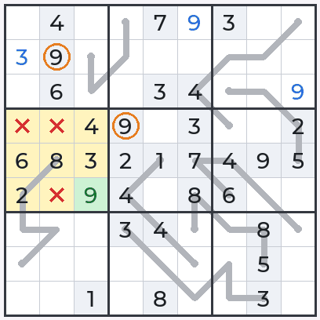

<!-- Written by tools/walkthrough.py palindrome: edit the script, not this page. -->
# Palindrome, step 4: the 9 in box 4

**Step 4 of 50** · [← Step 3](step-03.md) · [All steps](../palindrome.md#the-whole-puzzle-step-by-step) · [Step 5 →](step-05.md)

Box 4 needs a 9. r4c1 and r4c2: row 4 has one (r4c4). r6c2: column 2 has one (r2c2). Only **r6c3** is left: **r6c3 = 9**.

**Step 4 of 50** · [← Step 3](step-03.md) · [All steps](../palindrome.md#the-whole-puzzle-step-by-step) · [Step 5 →](step-05.md)
