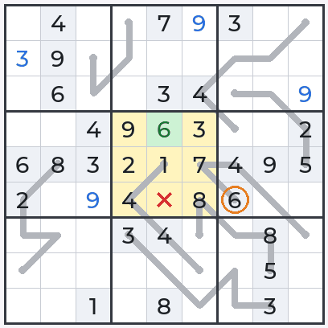

<!-- Written by tools/walkthrough.py palindrome: edit the script, not this page. -->
# Palindrome, step 5: the 6 in box 5

**Step 5 of 50** · [← Step 4](step-04.md) · [All steps](../palindrome.md#the-whole-puzzle-step-by-step) · [Step 6 →](step-06.md)

Box 5 needs a 6. r6c5: row 6 has one (r6c7). Only **r4c5** is left: **r4c5 = 6**.

**Step 5 of 50** · [← Step 4](step-04.md) · [All steps](../palindrome.md#the-whole-puzzle-step-by-step) · [Step 6 →](step-06.md)
