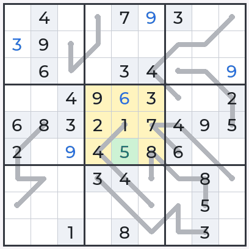

<!-- Written by tools/walkthrough.py palindrome: edit the script, not this page. -->
# Palindrome, step 6: the 5 in box 5

**Step 6 of 50** · [← Step 5](step-05.md) · [All steps](../palindrome.md#the-whole-puzzle-step-by-step) · [Step 7 →](step-07.md)

Box 5 needs a 5, and r6c5 is its last empty cell: **r6c5 = 5**.

**Step 6 of 50** · [← Step 5](step-05.md) · [All steps](../palindrome.md#the-whole-puzzle-step-by-step) · [Step 7 →](step-07.md)
