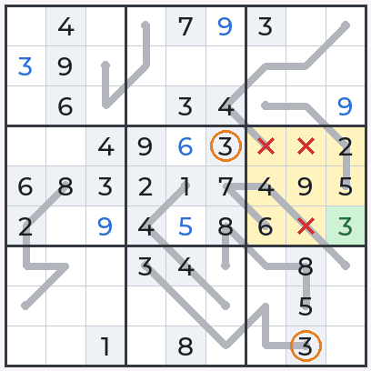

<!-- Written by tools/walkthrough.py palindrome: edit the script, not this page. -->
# Palindrome, step 7: the 3 in box 6

**Step 7 of 50** · [← Step 6](step-06.md) · [All steps](../palindrome.md#the-whole-puzzle-step-by-step) · [Step 8 →](step-08.md)

Box 6 needs a 3. r4c7 and r4c8: row 4 has one (r4c6). r6c8: column 8 has one (r9c8). Only **r6c9** is left: **r6c9 = 3**.

**Step 7 of 50** · [← Step 6](step-06.md) · [All steps](../palindrome.md#the-whole-puzzle-step-by-step) · [Step 8 →](step-08.md)
