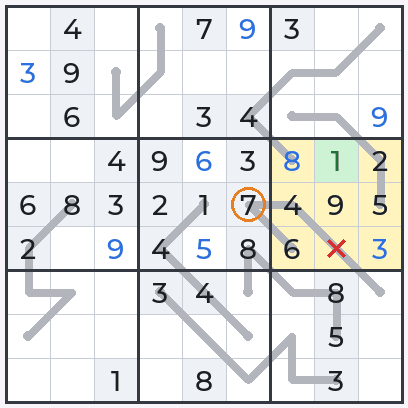

<!-- Written by tools/walkthrough.py palindrome: edit the script, not this page. -->
# Palindrome, step 9: the 1 in box 6

**Step 9 of 50** · [← Step 8](step-08.md) · [All steps](../palindrome.md#the-whole-puzzle-step-by-step) · [Step 10 →](step-10.md)

Box 6 needs a 1. r6c8: it mirrors the 7 in r5c6 on its grey line, which reads the same from both ends. Only **r4c8** is left: **r4c8 = 1**.

**Step 9 of 50** · [← Step 8](step-08.md) · [All steps](../palindrome.md#the-whole-puzzle-step-by-step) · [Step 10 →](step-10.md)
