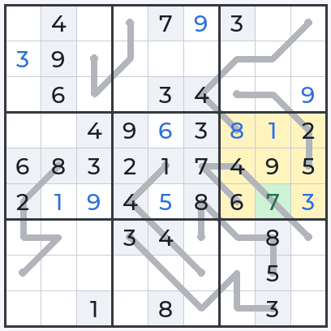

<!-- Written by tools/walkthrough.py palindrome: edit the script, not this page. -->
# Palindrome, step 11: the 7 in box 6

**Step 11 of 50** · [← Step 10](step-10.md) · [All steps](../palindrome.md#the-whole-puzzle-step-by-step) · [Step 12 →](step-12.md)

Box 6 needs a 7, and r6c8 is its last empty cell: **r6c8 = 7**.

**Step 11 of 50** · [← Step 10](step-10.md) · [All steps](../palindrome.md#the-whole-puzzle-step-by-step) · [Step 12 →](step-12.md)
