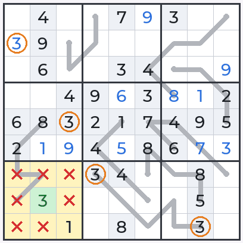

<!-- Written by tools/walkthrough.py palindrome: edit the script, not this page. -->
# Palindrome, step 12: the 3 in box 7

**Step 12 of 50** · [← Step 11](step-11.md) · [All steps](../palindrome.md#the-whole-puzzle-step-by-step) · [Step 13 →](step-13.md)

Box 7 needs a 3. r7c1, r7c2 and r7c3: row 7 has one (r7c4). r8c1: column 1 has one (r2c1). r8c3: column 3 has one (r5c3). r9c1 and r9c2: row 9 has one (r9c8). Only **r8c2** is left: **r8c2 = 3**.

**Step 12 of 50** · [← Step 11](step-11.md) · [All steps](../palindrome.md#the-whole-puzzle-step-by-step) · [Step 13 →](step-13.md)
