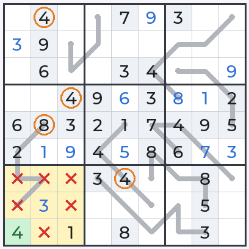

<!-- Written by tools/walkthrough.py palindrome: edit the script, not this page. -->
# Palindrome, step 13: the 4 in box 7

**Step 13 of 50** · [← Step 12](step-12.md) · [All steps](../palindrome.md#the-whole-puzzle-step-by-step) · [Step 14 →](step-14.md)

Box 7 needs a 4. r7c1, r7c2 and r7c3: row 7 has one (r7c5). r8c3: column 3 has one (r4c3). r9c2: column 2 has one (r1c2). r8c1: it mirrors the 8 in r5c2 on its grey line, which reads the same from both ends. Only **r9c1** is left: **r9c1 = 4**.

**Step 13 of 50** · [← Step 12](step-12.md) · [All steps](../palindrome.md#the-whole-puzzle-step-by-step) · [Step 14 →](step-14.md)
