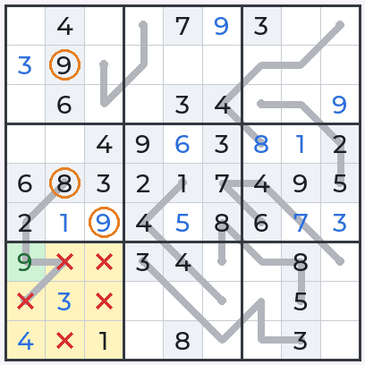

<!-- Written by tools/walkthrough.py palindrome: edit the script, not this page. -->
# Palindrome, step 14: the 9 in box 7

**Step 14 of 50** · [← Step 13](step-13.md) · [All steps](../palindrome.md#the-whole-puzzle-step-by-step) · [Step 15 →](step-15.md)

Box 7 needs a 9. r7c2 and r9c2: column 2 has one (r2c2). r7c3 and r8c3: column 3 has one (r6c3). r8c1: it mirrors the 8 in r5c2 on its grey line, which reads the same from both ends. Only **r7c1** is left: **r7c1 = 9**.

**Step 14 of 50** · [← Step 13](step-13.md) · [All steps](../palindrome.md#the-whole-puzzle-step-by-step) · [Step 15 →](step-15.md)
