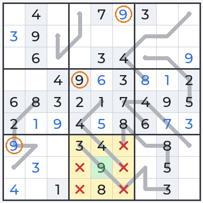

<!-- Written by tools/walkthrough.py palindrome: edit the script, not this page. -->
# Palindrome, step 15: the 9 in box 8

**Step 15 of 50** · [← Step 14](step-14.md) · [All steps](../palindrome.md#the-whole-puzzle-step-by-step) · [Step 16 →](step-16.md)

Box 8 needs a 9. r7c6: row 7 has one (r7c1). r8c4 and r9c4: column 4 has one (r4c4). r8c6 and r9c6: column 6 has one (r1c6). Only **r8c5** is left: **r8c5 = 9**.

**Step 15 of 50** · [← Step 14](step-14.md) · [All steps](../palindrome.md#the-whole-puzzle-step-by-step) · [Step 16 →](step-16.md)
