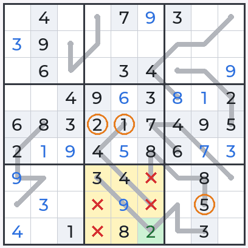

<!-- Written by tools/walkthrough.py palindrome: edit the script, not this page. -->
# Palindrome, step 16: the 2 in box 8

**Step 16 of 50** · [← Step 15](step-15.md) · [All steps](../palindrome.md#the-whole-puzzle-step-by-step) · [Step 17 →](step-17.md)

Box 8 needs a 2. r8c4 and r9c4: column 4 has one (r5c4). r7c6: it mirrors the 5 in r8c8 on its grey line, which reads the same from both ends. r8c6: it mirrors the 1 in r5c5 on its grey line, which reads the same from both ends. Only **r9c6** is left: **r9c6 = 2**.

**Step 16 of 50** · [← Step 15](step-15.md) · [All steps](../palindrome.md#the-whole-puzzle-step-by-step) · [Step 17 →](step-17.md)
