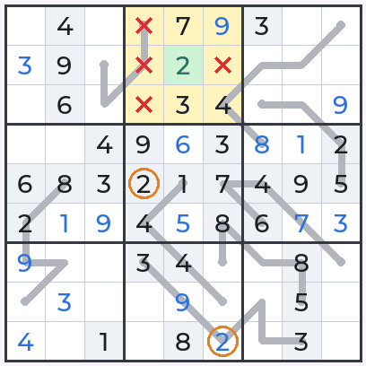

<!-- Written by tools/walkthrough.py palindrome: edit the script, not this page. -->
# Palindrome, step 17: the 2 in box 2

**Step 17 of 50** · [← Step 16](step-16.md) · [All steps](../palindrome.md#the-whole-puzzle-step-by-step) · [Step 18 →](step-18.md)

Box 2 needs a 2. r1c4, r2c4 and r3c4: column 4 has one (r5c4). r2c6: column 6 has one (r9c6). Only **r2c5** is left: **r2c5 = 2**.

**Step 17 of 50** · [← Step 16](step-16.md) · [All steps](../palindrome.md#the-whole-puzzle-step-by-step) · [Step 18 →](step-18.md)
