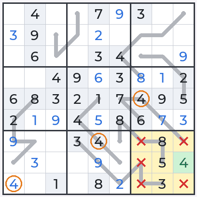

<!-- Written by tools/walkthrough.py palindrome: edit the script, not this page. -->
# Palindrome, step 18: the 4 in box 9

**Step 18 of 50** · [← Step 17](step-17.md) · [All steps](../palindrome.md#the-whole-puzzle-step-by-step) · [Step 19 →](step-19.md)

Box 9 needs a 4. r7c7 and r7c9: row 7 has one (r7c5). r8c7: column 7 has one (r5c7). r9c7 and r9c9: row 9 has one (r9c1). Only **r8c9** is left: **r8c9 = 4**.

**Step 18 of 50** · [← Step 17](step-17.md) · [All steps](../palindrome.md#the-whole-puzzle-step-by-step) · [Step 19 →](step-19.md)
