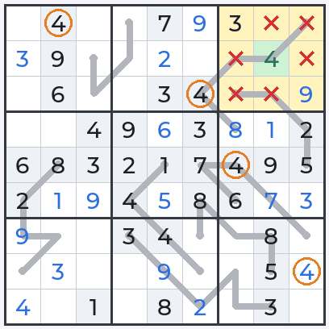

<!-- Written by tools/walkthrough.py palindrome: edit the script, not this page. -->
# Palindrome, step 19: the 4 in box 3

**Step 19 of 50** · [← Step 18](step-18.md) · [All steps](../palindrome.md#the-whole-puzzle-step-by-step) · [Step 20 →](step-20.md)

Box 3 needs a 4. r1c8 and r1c9: row 1 has one (r1c2). r2c7: column 7 has one (r5c7). r2c9: column 9 has one (r8c9). r3c7 and r3c8: row 3 has one (r3c6). Only **r2c8** is left: **r2c8 = 4**.

**Step 19 of 50** · [← Step 18](step-18.md) · [All steps](../palindrome.md#the-whole-puzzle-step-by-step) · [Step 20 →](step-20.md)
