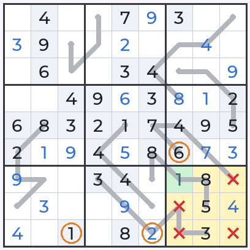

<!-- Written by tools/walkthrough.py palindrome: edit the script, not this page. -->
# Palindrome, step 20: the 1 in box 9

**Step 20 of 50** · [← Step 19](step-19.md) · [All steps](../palindrome.md#the-whole-puzzle-step-by-step) · [Step 21 →](step-21.md)

Box 9 needs a 1. r9c7 and r9c9: row 9 has one (r9c3). r7c9: it mirrors the 6 in r6c7 on its grey line, which reads the same from both ends. r8c7: it mirrors the 2 in r9c6 on its grey line, which reads the same from both ends. Only **r7c7** is left: **r7c7 = 1**.

**Step 20 of 50** · [← Step 19](step-19.md) · [All steps](../palindrome.md#the-whole-puzzle-step-by-step) · [Step 21 →](step-21.md)
