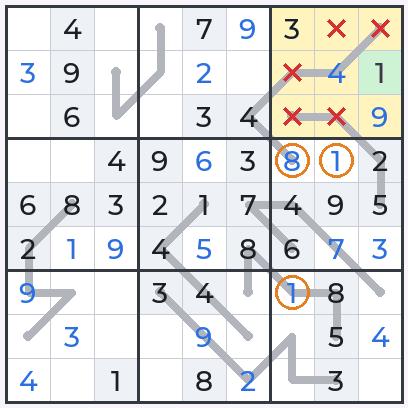

<!-- Written by tools/walkthrough.py palindrome: edit the script, not this page. -->
# Palindrome, step 21: the 1 in box 3

**Step 21 of 50** · [← Step 20](step-20.md) · [All steps](../palindrome.md#the-whole-puzzle-step-by-step) · [Step 22 →](step-22.md)

Box 3 needs a 1. r1c8 and r3c8: column 8 has one (r4c8). r2c7 and r3c7: column 7 has one (r7c7). r1c9: it mirrors the 8 in r4c7 on its grey line, which reads the same from both ends. Only **r2c9** is left: **r2c9 = 1**.

**Step 21 of 50** · [← Step 20](step-20.md) · [All steps](../palindrome.md#the-whole-puzzle-step-by-step) · [Step 22 →](step-22.md)
