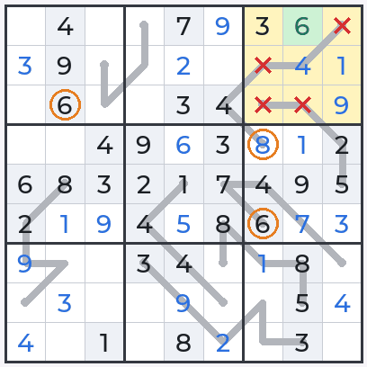

<!-- Written by tools/walkthrough.py palindrome: edit the script, not this page. -->
# Palindrome, step 22: the 6 in box 3

**Step 22 of 50** · [← Step 21](step-21.md) · [All steps](../palindrome.md#the-whole-puzzle-step-by-step) · [Step 23 →](step-23.md)

Box 3 needs a 6. r2c7: column 7 has one (r6c7). r3c7 and r3c8: row 3 has one (r3c2). r1c9: it mirrors the 8 in r4c7 on its grey line, which reads the same from both ends. Only **r1c8** is left: **r1c8 = 6**.

**Step 22 of 50** · [← Step 21](step-21.md) · [All steps](../palindrome.md#the-whole-puzzle-step-by-step) · [Step 23 →](step-23.md)
