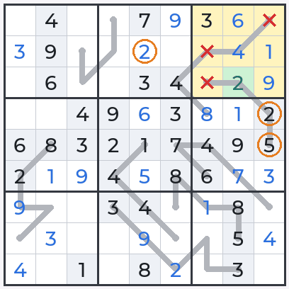

<!-- Written by tools/walkthrough.py palindrome: edit the script, not this page. -->
# Palindrome, step 23: the 2 in box 3

**Step 23 of 50** · [← Step 22](step-22.md) · [All steps](../palindrome.md#the-whole-puzzle-step-by-step) · [Step 24 →](step-24.md)

Box 3 needs a 2. r1c9: column 9 has one (r4c9). r2c7: row 2 has one (r2c5). r3c7: it mirrors the 5 in r5c9 on its grey line, which reads the same from both ends. Only **r3c8** is left: **r3c8 = 2**.

**Step 23 of 50** · [← Step 22](step-22.md) · [All steps](../palindrome.md#the-whole-puzzle-step-by-step) · [Step 24 →](step-24.md)
