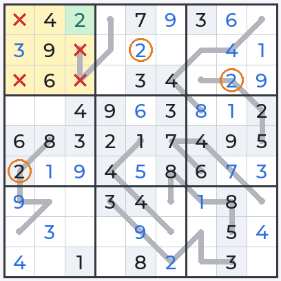

<!-- Written by tools/walkthrough.py palindrome: edit the script, not this page. -->
# Palindrome, step 24: the 2 in box 1

**Step 24 of 50** · [← Step 23](step-23.md) · [All steps](../palindrome.md#the-whole-puzzle-step-by-step) · [Step 25 →](step-25.md)

Box 1 needs a 2. r1c1: column 1 has one (r6c1). r2c3: row 2 has one (r2c5). r3c1 and r3c3: row 3 has one (r3c8). Only **r1c3** is left: **r1c3 = 2**.

**Step 24 of 50** · [← Step 23](step-23.md) · [All steps](../palindrome.md#the-whole-puzzle-step-by-step) · [Step 25 →](step-25.md)
