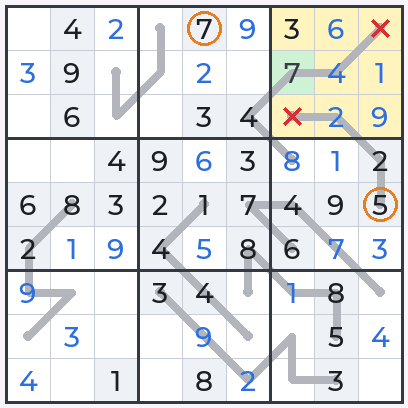

<!-- Written by tools/walkthrough.py palindrome: edit the script, not this page. -->
# Palindrome, step 25: the 7 in box 3

**Step 25 of 50** · [← Step 24](step-24.md) · [All steps](../palindrome.md#the-whole-puzzle-step-by-step) · [Step 26 →](step-26.md)

Box 3 needs a 7. r1c9: row 1 has one (r1c5). r3c7: it mirrors the 5 in r5c9 on its grey line, which reads the same from both ends. Only **r2c7** is left: **r2c7 = 7**.

**Step 25 of 50** · [← Step 24](step-24.md) · [All steps](../palindrome.md#the-whole-puzzle-step-by-step) · [Step 26 →](step-26.md)
