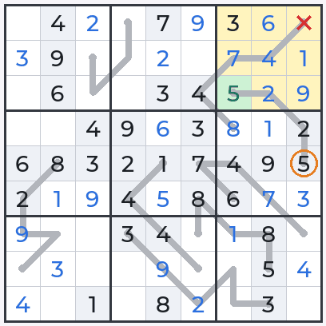

<!-- Written by tools/walkthrough.py palindrome: edit the script, not this page. -->
# Palindrome, step 26: the 5 in box 3

**Step 26 of 50** · [← Step 25](step-25.md) · [All steps](../palindrome.md#the-whole-puzzle-step-by-step) · [Step 27 →](step-27.md)

Box 3 needs a 5. r1c9: column 9 has one (r5c9). Only **r3c7** is left: **r3c7 = 5**.

**Step 26 of 50** · [← Step 25](step-25.md) · [All steps](../palindrome.md#the-whole-puzzle-step-by-step) · [Step 27 →](step-27.md)
