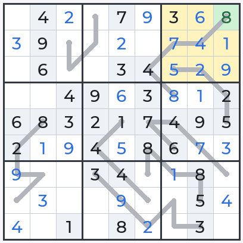

<!-- Written by tools/walkthrough.py palindrome: edit the script, not this page. -->
# Palindrome, step 27: the 8 in box 3

**Step 27 of 50** · [← Step 26](step-26.md) · [All steps](../palindrome.md#the-whole-puzzle-step-by-step) · [Step 28 →](step-28.md)

Box 3 needs an 8, and r1c9 is its last empty cell: **r1c9 = 8**.

**Step 27 of 50** · [← Step 26](step-26.md) · [All steps](../palindrome.md#the-whole-puzzle-step-by-step) · [Step 28 →](step-28.md)
