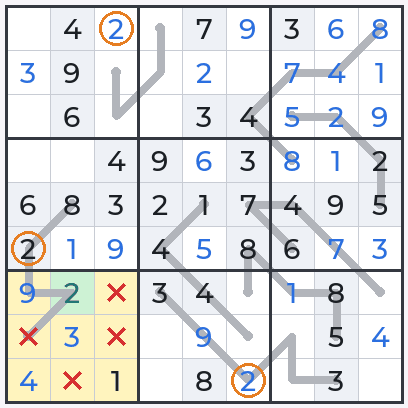

<!-- Written by tools/walkthrough.py palindrome: edit the script, not this page. -->
# Palindrome, step 28: the 2 in box 7

**Step 28 of 50** · [← Step 27](step-27.md) · [All steps](../palindrome.md#the-whole-puzzle-step-by-step) · [Step 29 →](step-29.md)

Box 7 needs a 2. r7c3 and r8c3: column 3 has one (r1c3). r8c1: column 1 has one (r6c1). r9c2: row 9 has one (r9c6). Only **r7c2** is left: **r7c2 = 2**.

**Step 28 of 50** · [← Step 27](step-27.md) · [All steps](../palindrome.md#the-whole-puzzle-step-by-step) · [Step 29 →](step-29.md)
