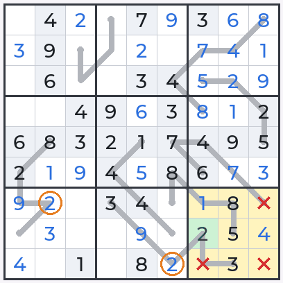

<!-- Written by tools/walkthrough.py palindrome: edit the script, not this page. -->
# Palindrome, step 29: the 2 in box 9

**Step 29 of 50** · [← Step 28](step-28.md) · [All steps](../palindrome.md#the-whole-puzzle-step-by-step) · [Step 30 →](step-30.md)

Box 9 needs a 2. r7c9: row 7 has one (r7c2). r9c7 and r9c9: row 9 has one (r9c6). Only **r8c7** is left: **r8c7 = 2**.

**Step 29 of 50** · [← Step 28](step-28.md) · [All steps](../palindrome.md#the-whole-puzzle-step-by-step) · [Step 30 →](step-30.md)
