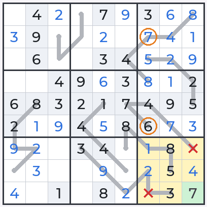

<!-- Written by tools/walkthrough.py palindrome: edit the script, not this page. -->
# Palindrome, step 30: the 7 in box 9

**Step 30 of 50** · [← Step 29](step-29.md) · [All steps](../palindrome.md#the-whole-puzzle-step-by-step) · [Step 31 →](step-31.md)

Box 9 needs a 7. r9c7: column 7 has one (r2c7). r7c9: it mirrors the 6 in r6c7 on its grey line, which reads the same from both ends. Only **r9c9** is left: **r9c9 = 7**.

**Step 30 of 50** · [← Step 29](step-29.md) · [All steps](../palindrome.md#the-whole-puzzle-step-by-step) · [Step 31 →](step-31.md)
