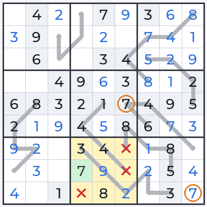

<!-- Written by tools/walkthrough.py palindrome: edit the script, not this page. -->
# Palindrome, step 31: the 7 in box 8

**Step 31 of 50** · [← Step 30](step-30.md) · [All steps](../palindrome.md#the-whole-puzzle-step-by-step) · [Step 32 →](step-32.md)

Box 8 needs a 7. r7c6 and r8c6: column 6 has one (r5c6). r9c4: row 9 has one (r9c9). Only **r8c4** is left: **r8c4 = 7**.

**Step 31 of 50** · [← Step 30](step-30.md) · [All steps](../palindrome.md#the-whole-puzzle-step-by-step) · [Step 32 →](step-32.md)
