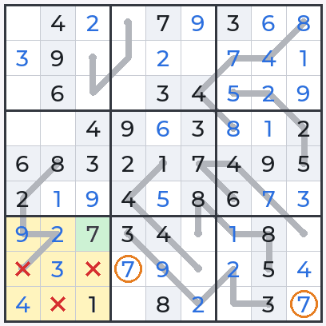

<!-- Written by tools/walkthrough.py palindrome: edit the script, not this page. -->
# Palindrome, step 32: the 7 in box 7

**Step 32 of 50** · [← Step 31](step-31.md) · [All steps](../palindrome.md#the-whole-puzzle-step-by-step) · [Step 33 →](step-33.md)

Box 7 needs a 7. r8c1 and r8c3: row 8 has one (r8c4). r9c2: row 9 has one (r9c9). Only **r7c3** is left: **r7c3 = 7**.

**Step 32 of 50** · [← Step 31](step-31.md) · [All steps](../palindrome.md#the-whole-puzzle-step-by-step) · [Step 33 →](step-33.md)
