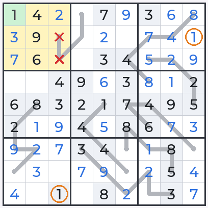

<!-- Written by tools/walkthrough.py palindrome: edit the script, not this page. -->
# Palindrome, step 34: the 1 in box 1

**Step 34 of 50** · [← Step 33](step-33.md) · [All steps](../palindrome.md#the-whole-puzzle-step-by-step) · [Step 35 →](step-35.md)

Box 1 needs a 1. r2c3: row 2 has one (r2c9). r3c3: column 3 has one (r9c3). Only **r1c1** is left: **r1c1 = 1**.

**Step 34 of 50** · [← Step 33](step-33.md) · [All steps](../palindrome.md#the-whole-puzzle-step-by-step) · [Step 35 →](step-35.md)
