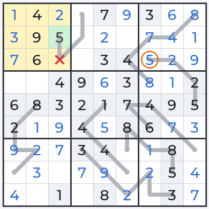

<!-- Written by tools/walkthrough.py palindrome: edit the script, not this page. -->
# Palindrome, step 35: the 5 in box 1

**Step 35 of 50** · [← Step 34](step-34.md) · [All steps](../palindrome.md#the-whole-puzzle-step-by-step) · [Step 36 →](step-36.md)

Box 1 needs a 5. r3c3: row 3 has one (r3c7). Only **r2c3** is left: **r2c3 = 5**.

**Step 35 of 50** · [← Step 34](step-34.md) · [All steps](../palindrome.md#the-whole-puzzle-step-by-step) · [Step 36 →](step-36.md)
