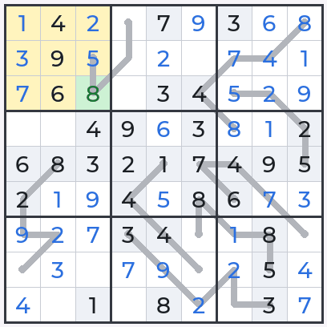

<!-- Written by tools/walkthrough.py palindrome: edit the script, not this page. -->
# Palindrome, step 36: the 8 in box 1

**Step 36 of 50** · [← Step 35](step-35.md) · [All steps](../palindrome.md#the-whole-puzzle-step-by-step) · [Step 37 →](step-37.md)

Box 1 needs an 8, and r3c3 is its last empty cell: **r3c3 = 8**.

**Step 36 of 50** · [← Step 35](step-35.md) · [All steps](../palindrome.md#the-whole-puzzle-step-by-step) · [Step 37 →](step-37.md)
