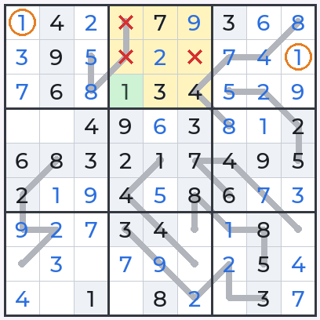

<!-- Written by tools/walkthrough.py palindrome: edit the script, not this page. -->
# Palindrome, step 37: the 1 in box 2

**Step 37 of 50** · [← Step 36](step-36.md) · [All steps](../palindrome.md#the-whole-puzzle-step-by-step) · [Step 38 →](step-38.md)

Box 2 needs a 1. r1c4: row 1 has one (r1c1). r2c4 and r2c6: row 2 has one (r2c9). Only **r3c4** is left: **r3c4 = 1**.

**Step 37 of 50** · [← Step 36](step-36.md) · [All steps](../palindrome.md#the-whole-puzzle-step-by-step) · [Step 38 →](step-38.md)
