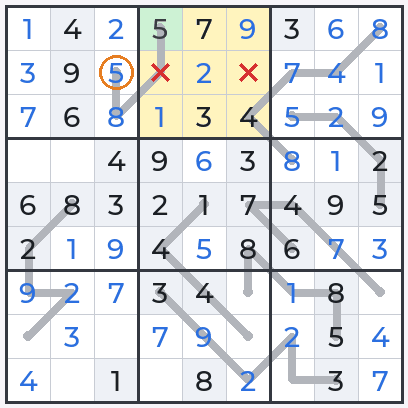

<!-- Written by tools/walkthrough.py palindrome: edit the script, not this page. -->
# Palindrome, step 38: the 5 in box 2

**Step 38 of 50** · [← Step 37](step-37.md) · [All steps](../palindrome.md#the-whole-puzzle-step-by-step) · [Step 39 →](step-39.md)

Box 2 needs a 5. r2c4 and r2c6: row 2 has one (r2c3). Only **r1c4** is left: **r1c4 = 5**.

**Step 38 of 50** · [← Step 37](step-37.md) · [All steps](../palindrome.md#the-whole-puzzle-step-by-step) · [Step 39 →](step-39.md)
