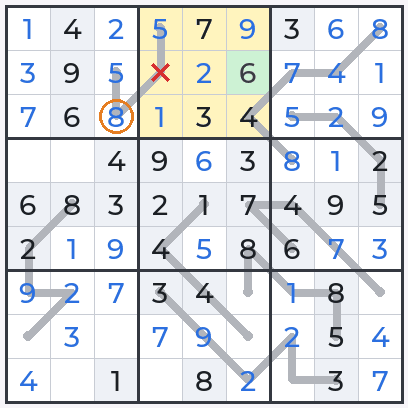

<!-- Written by tools/walkthrough.py palindrome: edit the script, not this page. -->
# Palindrome, step 39: the 6 in box 2

**Step 39 of 50** · [← Step 38](step-38.md) · [All steps](../palindrome.md#the-whole-puzzle-step-by-step) · [Step 40 →](step-40.md)

Box 2 needs a 6. r2c4: it mirrors the 8 in r3c3 on its grey line, which reads the same from both ends. Only **r2c6** is left: **r2c6 = 6**.

**Step 39 of 50** · [← Step 38](step-38.md) · [All steps](../palindrome.md#the-whole-puzzle-step-by-step) · [Step 40 →](step-40.md)
