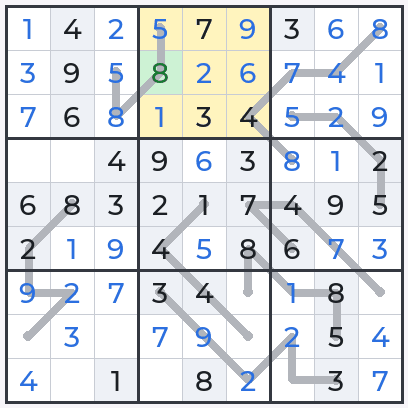

<!-- Written by tools/walkthrough.py palindrome: edit the script, not this page. -->
# Palindrome, step 40: the 8 in box 2

**Step 40 of 50** · [← Step 39](step-39.md) · [All steps](../palindrome.md#the-whole-puzzle-step-by-step) · [Step 41 →](step-41.md)

Box 2 needs an 8, and r2c4 is its last empty cell: **r2c4 = 8**.

**Step 40 of 50** · [← Step 39](step-39.md) · [All steps](../palindrome.md#the-whole-puzzle-step-by-step) · [Step 41 →](step-41.md)
