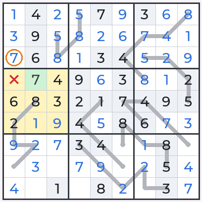

<!-- Written by tools/walkthrough.py palindrome: edit the script, not this page. -->
# Palindrome, step 41: the 7 in box 4

**Step 41 of 50** · [← Step 40](step-40.md) · [All steps](../palindrome.md#the-whole-puzzle-step-by-step) · [Step 42 →](step-42.md)

Box 4 needs a 7. r4c1: column 1 has one (r3c1). Only **r4c2** is left: **r4c2 = 7**.

**Step 41 of 50** · [← Step 40](step-40.md) · [All steps](../palindrome.md#the-whole-puzzle-step-by-step) · [Step 42 →](step-42.md)
