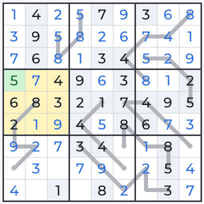

<!-- Written by tools/walkthrough.py palindrome: edit the script, not this page. -->
# Palindrome, step 42: the 5 in box 4

**Step 42 of 50** · [← Step 41](step-41.md) · [All steps](../palindrome.md#the-whole-puzzle-step-by-step) · [Step 43 →](step-43.md)

Box 4 needs a 5, and r4c1 is its last empty cell: **r4c1 = 5**.

**Step 42 of 50** · [← Step 41](step-41.md) · [All steps](../palindrome.md#the-whole-puzzle-step-by-step) · [Step 43 →](step-43.md)
