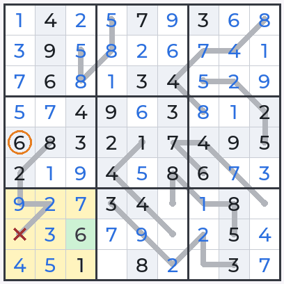

<!-- Written by tools/walkthrough.py palindrome: edit the script, not this page. -->
# Palindrome, step 44: the 6 in box 7

**Step 44 of 50** · [← Step 43](step-43.md) · [All steps](../palindrome.md#the-whole-puzzle-step-by-step) · [Step 45 →](step-45.md)

Box 7 needs a 6. r8c1: column 1 has one (r5c1). Only **r8c3** is left: **r8c3 = 6**.

**Step 44 of 50** · [← Step 43](step-43.md) · [All steps](../palindrome.md#the-whole-puzzle-step-by-step) · [Step 45 →](step-45.md)
