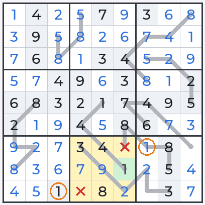

<!-- Written by tools/walkthrough.py palindrome: edit the script, not this page. -->
# Palindrome, step 46: the 1 in box 8

**Step 46 of 50** · [← Step 45](step-45.md) · [All steps](../palindrome.md#the-whole-puzzle-step-by-step) · [Step 47 →](step-47.md)

Box 8 needs a 1. r7c6: row 7 has one (r7c7). r9c4: row 9 has one (r9c3). Only **r8c6** is left: **r8c6 = 1**.

**Step 46 of 50** · [← Step 45](step-45.md) · [All steps](../palindrome.md#the-whole-puzzle-step-by-step) · [Step 47 →](step-47.md)
