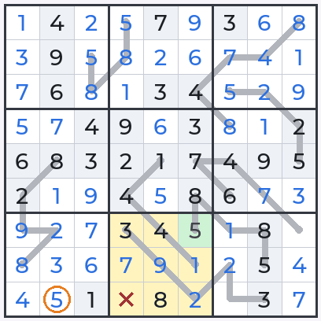

<!-- Written by tools/walkthrough.py palindrome: edit the script, not this page. -->
# Palindrome, step 47: the 5 in box 8

**Step 47 of 50** · [← Step 46](step-46.md) · [All steps](../palindrome.md#the-whole-puzzle-step-by-step) · [Step 48 →](step-48.md)

Box 8 needs a 5. r9c4: row 9 has one (r9c2). Only **r7c6** is left: **r7c6 = 5**.

**Step 47 of 50** · [← Step 46](step-46.md) · [All steps](../palindrome.md#the-whole-puzzle-step-by-step) · [Step 48 →](step-48.md)
