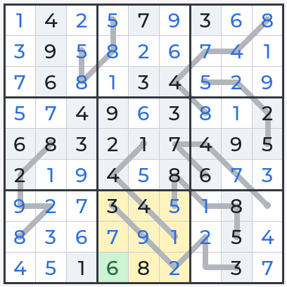

<!-- Written by tools/walkthrough.py palindrome: edit the script, not this page. -->
# Palindrome, step 48: the 6 in box 8

**Step 48 of 50** · [← Step 47](step-47.md) · [All steps](../palindrome.md#the-whole-puzzle-step-by-step) · [Step 49 →](step-49.md)

Box 8 needs a 6, and r9c4 is its last empty cell: **r9c4 = 6**.

**Step 48 of 50** · [← Step 47](step-47.md) · [All steps](../palindrome.md#the-whole-puzzle-step-by-step) · [Step 49 →](step-49.md)
