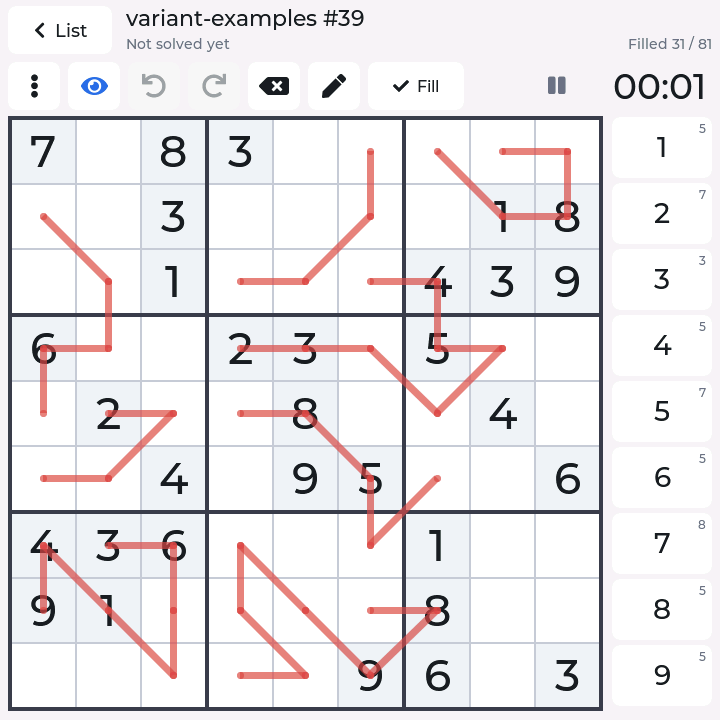
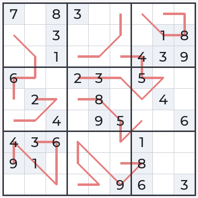

# Parity Lines

[← All variants](README.md) · [Puzzles](../features-puzzles.md) · [How to play](../how-to-play.md)

## The rules

[Classic](classic.md) rules, plus **red lines** through cells side by side or diagonal. Along a line, **two neighbours are one odd and one even digit**: 3, 8, 1, 6, 7. So the digits on a line alternate odd, even, odd, ... (or even, odd, even, ...).

## On the board

- Each line is a narrow red line under the digits.
- Two odd or two even neighbours on a line turn red.
- The grader and hints narrow each line cell by its neighbours: "Along this line, neighbours are one odd and one even digit, so row 5, column 3 can only be 1, 3".
- **Puzzles → ⋮ → New puzzle → Lines → Parity**: 8 lines (Hard and Expert 10) of 3 to 8 cells.

## How to solve it

- **One digit sets the whole line:** cells an odd number of steps from a known digit have the other parity, cells an even number of steps away the same one. Mark the line's cells odd or even as soon as one is known.
- **Count what's left:** there are five odd digits (1, 3, 5, 7, 9) and four even ones (2, 4, 6, 8). A row, column or box with many even line cells runs out of even digits fast.
- **Long lines in one box:** a line of 6 cells inside a box takes three odd and three even digits there, leaving that box's other three cells two odd and one even.

## Worked example

**variant-examples #39**, Parity Lines Easy (see [Classic](classic.md#worked-example-the-whole-puzzle) for how to import the examples; cells are written r*row*c*column*). The lines are in the screenshot; three matter here:

- r1c7, r2c8 (a 1), r2c9 (an 8), r1c9, r1c8;
- r3c6, r3c7 (a 4), r4c7 (a 5), r4c8, r5c7, r4c6, r4c5 (a 3), r4c4 (a 2);
- r8c1 (a 9), r7c1 (a 4), r8c2 (a 1), r9c3, r8c3, r7c3 (a 6), r7c2 (a 3).

**Step 1: r1c9, next to an 8.** Row 1 has 3, 7 and 8; column 9 has 6 and 9; box 3 has 1 and 4; that leaves 2 and 5. On its line, r1c9 is next to the 8 in r2c9, so it's odd. **r1c9 = 5**.

**Step 2: r4c8, next to a 5.** Row 4 has 2, 3, 5 and 6; column 8 has 1 and 4; that leaves 7, 8 and 9. On its line, r4c8 is next to the 5 in r4c7, so it's even. **r4c8 = 8**.

**Step 3: r9c3, next to a 1.** Row 9 has 3, 6 and 9; column 3 has 1, 4 and 8; that leaves 2, 5 and 7. On its line, r9c3 is next to the 1 in r8c2, so it's even. **r9c3 = 2**.

## The whole puzzle, step by step

<!-- walkthrough -->
<!-- Written by tools/walkthrough.py parity-lines: edit the script, not this part. -->

The whole puzzle, from the start to the last cell: 50 steps, each one a single (one place left for a digit, or one digit left for a cell), taken in the order a box's single comes first, so not quite the order of the worked example above. Each step has a page of its own, with **Previous** and **Next**: pick its number below. In each picture, the unit the step looks at is tinted yellow (for a cell with one digit left: its row, column and box), the new digit is on green, the digits that rule cells out have an **orange ring**, and the empty cells they rule out a **red cross**. Givens are on grey, digits from earlier steps in blue.

| [1](parity-lines/step-01.md) | [2](parity-lines/step-02.md) | [3](parity-lines/step-03.md) | [4](parity-lines/step-04.md) | [5](parity-lines/step-05.md) | [6](parity-lines/step-06.md) | [7](parity-lines/step-07.md) | [8](parity-lines/step-08.md) | [9](parity-lines/step-09.md) | [10](parity-lines/step-10.md) |
|:-:|:-:|:-:|:-:|:-:|:-:|:-:|:-:|:-:|:-:|
| [11](parity-lines/step-11.md) | [12](parity-lines/step-12.md) | [13](parity-lines/step-13.md) | [14](parity-lines/step-14.md) | [15](parity-lines/step-15.md) | [16](parity-lines/step-16.md) | [17](parity-lines/step-17.md) | [18](parity-lines/step-18.md) | [19](parity-lines/step-19.md) | [20](parity-lines/step-20.md) |
| [21](parity-lines/step-21.md) | [22](parity-lines/step-22.md) | [23](parity-lines/step-23.md) | [24](parity-lines/step-24.md) | [25](parity-lines/step-25.md) | [26](parity-lines/step-26.md) | [27](parity-lines/step-27.md) | [28](parity-lines/step-28.md) | [29](parity-lines/step-29.md) | [30](parity-lines/step-30.md) |
| [31](parity-lines/step-31.md) | [32](parity-lines/step-32.md) | [33](parity-lines/step-33.md) | [34](parity-lines/step-34.md) | [35](parity-lines/step-35.md) | [36](parity-lines/step-36.md) | [37](parity-lines/step-37.md) | [38](parity-lines/step-38.md) | [39](parity-lines/step-39.md) | [40](parity-lines/step-40.md) |
| [41](parity-lines/step-41.md) | [42](parity-lines/step-42.md) | [43](parity-lines/step-43.md) | [44](parity-lines/step-44.md) | [45](parity-lines/step-45.md) | [46](parity-lines/step-46.md) | [47](parity-lines/step-47.md) | [48](parity-lines/step-48.md) | [49](parity-lines/step-49.md) | [50](parity-lines/step-50.md) |

Solved.

<!-- /walkthrough -->
