# Parity Lines

[← All variants](README.md) · [Puzzles](../features-puzzles.md) · [How to play](../how-to-play.md)

## The rules

[Classic](classic.md) rules, plus **red lines** through cells side by side or diagonal. Along a line, **two neighbours are one odd and one even digit**: 3, 8, 1, 6, 7. So the digits on a line alternate odd, even, odd, ... (or even, odd, even, ...).

## On the board

- Each line is a narrow red line under the digits.
- Two odd or two even neighbours on a line turn red.
- The grader and hints narrow each line cell by its neighbours: "Along this line, neighbours are one odd and one even digit, so row 5, column 3 can only be 1, 3".
- **Puzzles → ⋮ → New puzzle → Lines → Parity**: 8 lines (Hard and Expert 10) of 3 to 8 cells.

## How to solve it

- **One digit sets the whole line:** cells an odd number of steps from a known digit have the other parity, cells an even number of steps away the same one. Mark the line's cells odd or even as soon as one is known.
- **Count what's left:** there are five odd digits (1, 3, 5, 7, 9) and four even ones (2, 4, 6, 8). A row, column or box with many even line cells runs out of even digits fast.
- **Long lines in one box:** a line of 6 cells inside a box takes three odd and three even digits there, leaving that box's other three cells two odd and one even.

## Worked example

**variant-examples #39**, Parity Lines Easy (see [Classic](classic.md#worked-example-the-whole-puzzle) for how to import the examples; cells are written r*row*c*column*). The lines are in the screenshot; three matter here:

- r1c7, r2c8 (a 1), r2c9 (an 8), r1c9, r1c8;
- r3c6, r3c7 (a 4), r4c7 (a 5), r4c8, r5c7, r4c6, r4c5 (a 3), r4c4 (a 2);
- r8c1 (a 9), r7c1 (a 4), r8c2 (a 1), r9c3, r8c3, r7c3 (a 6), r7c2 (a 3).

**Step 1: r1c9, next to an 8.** Row 1 has 3, 7 and 8; column 9 has 6 and 9; box 3 has 1 and 4; that leaves 2 and 5. On its line, r1c9 is next to the 8 in r2c9, so it's odd. **r1c9 = 5**.

**Step 2: r4c8, next to a 5.** Row 4 has 2, 3, 5 and 6; column 8 has 1 and 4; that leaves 7, 8 and 9. On its line, r4c8 is next to the 5 in r4c7, so it's even. **r4c8 = 8**.

**Step 3: r9c3, next to a 1.** Row 9 has 3, 6 and 9; column 3 has 1, 4 and 8; that leaves 2, 5 and 7. On its line, r9c3 is next to the 1 in r8c2, so it's even. **r9c3 = 2**.

## The whole puzzle, step by step

<!-- walkthrough -->
<!-- Written by tools/walkthrough.py parity-lines: edit the script, not this part. -->

The whole puzzle, from the start to the last cell: 50 steps, each one a single (one place left for a digit, or one digit left for a cell), taken in the order a box's single comes first, so not quite the order of the worked example above. In each picture, the unit the step looks at is tinted yellow (for a cell with one digit left: its row, column and box), the new digit is on green, the digits that rule cells out have an **orange ring**, and the empty cells they rule out a **red cross**. Givens are on grey, digits from earlier steps in blue.

#### Step 1: the 8 in box 2

Box 2 needs an 8. r1c5 and r1c6: row 1 has one (r1c3). r2c4, r2c5 and r2c6: row 2 has one (r2c9). r3c5: column 5 has one (r5c5). r3c6: it's next to the 4 in r3c7 on a red line, and 8 is even too. Only **r3c4** is left: **r3c4 = 8**.

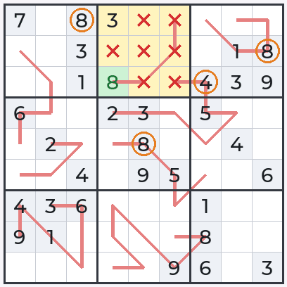

#### Step 2: the 9 in box 2

Box 2 needs a 9. r1c5 and r2c5: column 5 has one (r6c5). r1c6 and r2c6: column 6 has one (r9c6). r3c5 and r3c6: row 3 has one (r3c9). Only **r2c4** is left: **r2c4 = 9**.

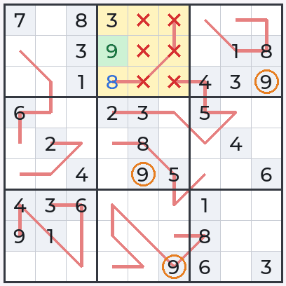

#### Step 3: the 9 in box 1

Box 1 needs a 9. r2c1 and r2c2: row 2 has one (r2c4). r3c1 and r3c2: row 3 has one (r3c9). Only **r1c2** is left: **r1c2 = 9**.

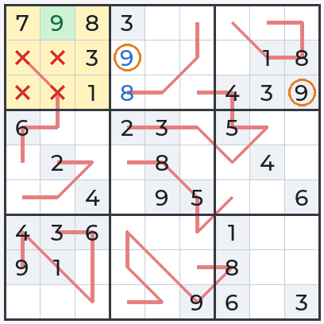

#### Step 4: the 4 in box 1

Box 1 needs a 4. r2c1: column 1 has one (r7c1). r3c1 and r3c2: row 3 has one (r3c7). Only **r2c2** is left: **r2c2 = 4**.

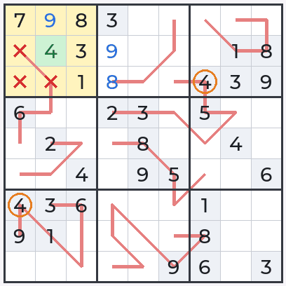

#### Step 5: the 6 in box 1

Box 1 needs a 6. r2c1 and r3c1: column 1 has one (r4c1). Only **r3c2** is left: **r3c2 = 6**.

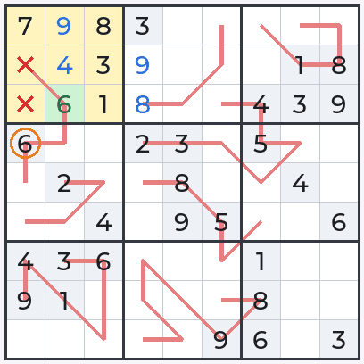

#### Step 6: the 2 in box 1

Box 1 needs a 2. r2c1: it's next to the 6 in r3c2 on a red line, and 2 is even too. Only **r3c1** is left: **r3c1 = 2**.

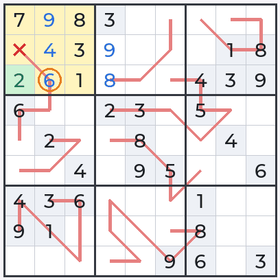

#### Step 7: the 5 in box 1

Box 1 needs a 5, and r2c1 is its last empty cell: **r2c1 = 5**.

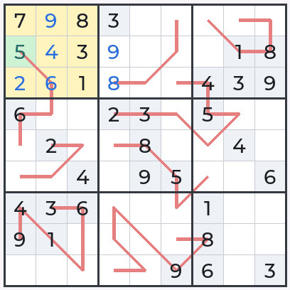

#### Step 8: the 6 in box 3

Box 3 needs a 6. r1c7 and r2c7: column 7 has one (r9c7). r1c9: column 9 has one (r6c9). Only **r1c8** is left: **r1c8 = 6**.

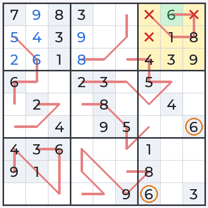

#### Step 9: the 5 in box 3

Box 3 needs a 5. r1c7: column 7 has one (r4c7). r2c7: row 2 has one (r2c1). Only **r1c9** is left: **r1c9 = 5**.

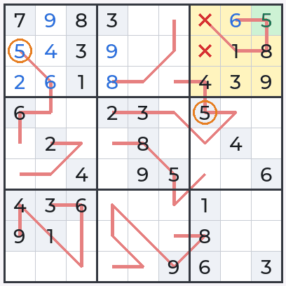

#### Step 10: the 5 in box 2

Box 2 needs a 5. r1c5 and r1c6: row 1 has one (r1c9). r2c5 and r2c6: row 2 has one (r2c1). r3c6: column 6 has one (r6c6). Only **r3c5** is left: **r3c5 = 5**.

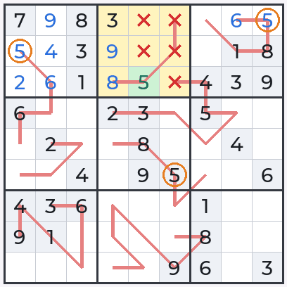

#### Step 11: the 7 in box 3

Box 3 needs a 7. r1c7: row 1 has one (r1c1). Only **r2c7** is left: **r2c7 = 7**.

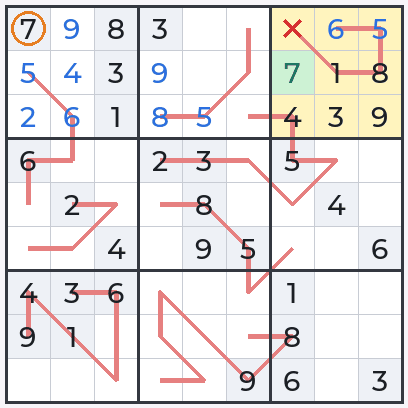

#### Step 12: the 7 in box 2

Box 2 needs a 7. r1c5 and r1c6: row 1 has one (r1c1). r2c5 and r2c6: row 2 has one (r2c7). Only **r3c6** is left: **r3c6 = 7**.

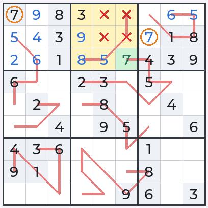

#### Step 13: the 2 in box 3

Box 3 needs a 2, and r1c7 is its last empty cell: **r1c7 = 2**.

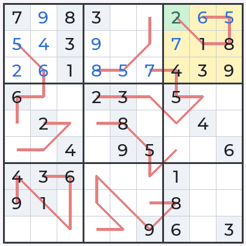

#### Step 14: the 5 in box 4

Box 4 needs a 5. r4c2 and r4c3: row 4 has one (r4c7). r5c1: column 1 has one (r2c1). r6c1 and r6c2: row 6 has one (r6c6). Only **r5c3** is left: **r5c3 = 5**.

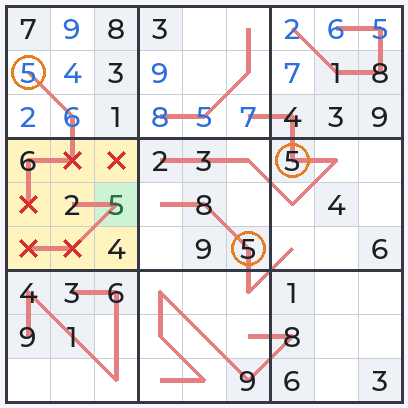

#### Step 15: the 9 in box 4

Box 4 needs a 9. r4c2: column 2 has one (r1c2). r5c1: column 1 has one (r8c1). r6c1 and r6c2: row 6 has one (r6c5). Only **r4c3** is left: **r4c3 = 9**.

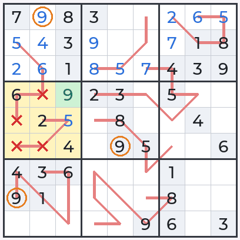

#### Step 16: the 7 in box 4

Box 4 needs a 7. r5c1 and r6c1: column 1 has one (r1c1). r6c2: it's next to the 5 in r5c3 on a red line, and 7 is odd too. Only **r4c2** is left: **r4c2 = 7**.

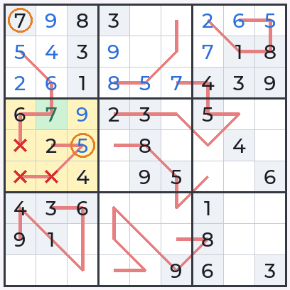

#### Step 17: the 4 in box 5

Box 5 needs a 4. r5c4 and r5c6: row 5 has one (r5c8). r6c4: row 6 has one (r6c3). Only **r4c6** is left: **r4c6 = 4**.

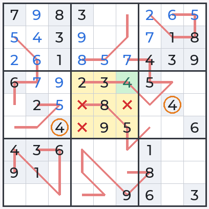

#### Step 18: the 4 in box 2

Box 2 needs a 4. r1c6: column 6 has one (r4c6). r2c5 and r2c6: row 2 has one (r2c2). Only **r1c5** is left: **r1c5 = 4**.

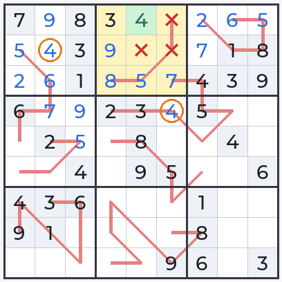

#### Step 19: the 1 in box 2

Box 2 needs a 1. r2c5 and r2c6: row 2 has one (r2c8). Only **r1c6** is left: **r1c6 = 1**.

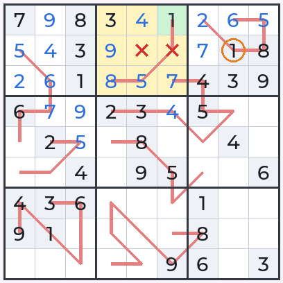

#### Step 20: the 6 in box 5

Box 5 needs a 6. r6c4: row 6 has one (r6c9). r5c4: it's next to the 8 in r5c5 on a red line, and 6 is even too. Only **r5c6** is left: **r5c6 = 6**.

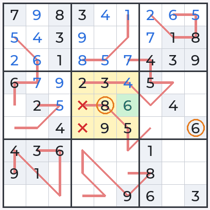

#### Step 21: the 6 in box 2

Box 2 needs a 6. r2c6: column 6 has one (r5c6). Only **r2c5** is left: **r2c5 = 6**.

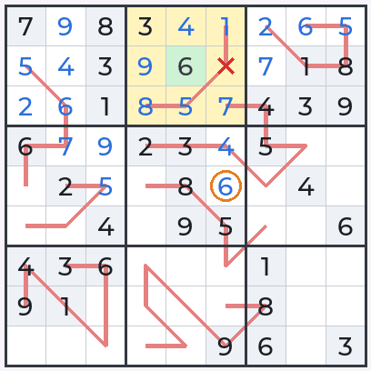

#### Step 22: the 2 in box 2

Box 2 needs a 2, and r2c6 is its last empty cell: **r2c6 = 2**.

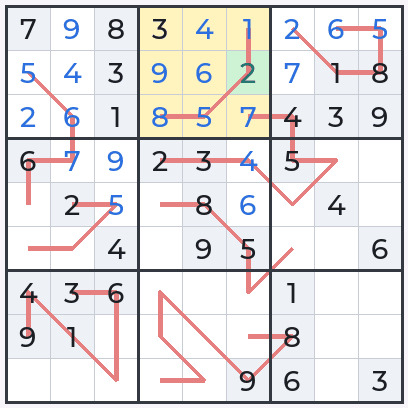

#### Step 23: the 2 in box 6

Box 6 needs a 2. r4c8 and r4c9: row 4 has one (r4c4). r5c7 and r5c9: row 5 has one (r5c2). r6c7: column 7 has one (r1c7). Only **r6c8** is left: **r6c8 = 2**.

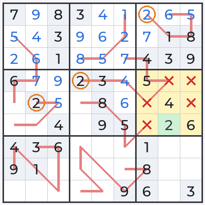

#### Step 24: the 7 in box 6

Box 6 needs a 7. r4c8 and r4c9: row 4 has one (r4c2). r5c7 and r6c7: column 7 has one (r2c7). Only **r5c9** is left: **r5c9 = 7**.

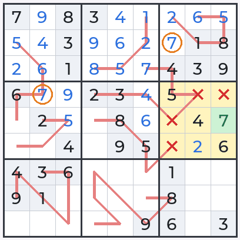

#### Step 25: the 7 in box 5

Box 5 needs a 7. r5c4: row 5 has one (r5c9). Only **r6c4** is left: **r6c4 = 7**.

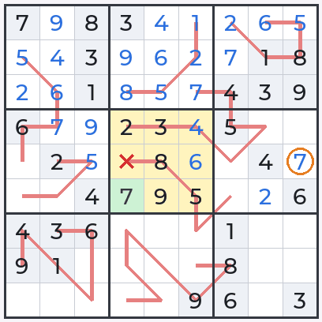

#### Step 26: the 1 in box 5

Box 5 needs a 1, and r5c4 is its last empty cell: **r5c4 = 1**.

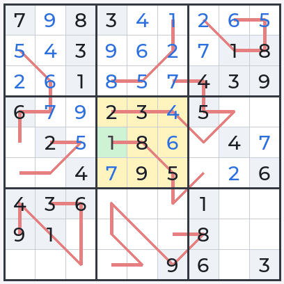

#### Step 27: the 1 in box 4

Box 4 needs a 1. r5c1: row 5 has one (r5c4). r6c2: column 2 has one (r8c2). Only **r6c1** is left: **r6c1 = 1**.

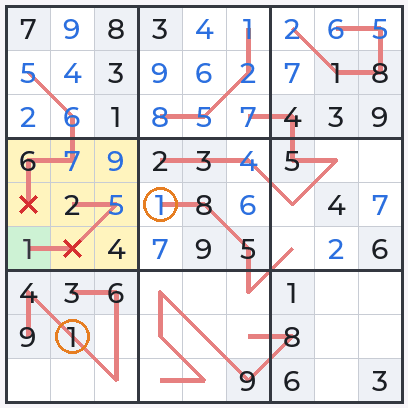

#### Step 28: the 3 in box 4

Box 4 needs a 3. r6c2: column 2 has one (r7c2). Only **r5c1** is left: **r5c1 = 3**.

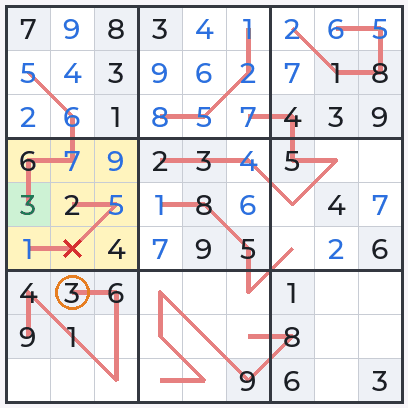

#### Step 29: the 8 in box 4

Box 4 needs an 8, and r6c2 is its last empty cell: **r6c2 = 8**.

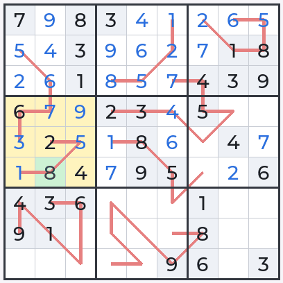

#### Step 30: the 1 in box 6

Box 6 needs a 1. r4c8: column 8 has one (r2c8). r5c7: row 5 has one (r5c4). r6c7: row 6 has one (r6c1). Only **r4c9** is left: **r4c9 = 1**.

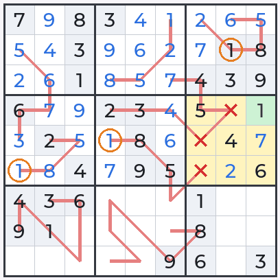

#### Step 31: the 3 in box 6

Box 6 needs a 3. r4c8: row 4 has one (r4c5). r5c7: row 5 has one (r5c1). Only **r6c7** is left: **r6c7 = 3**.

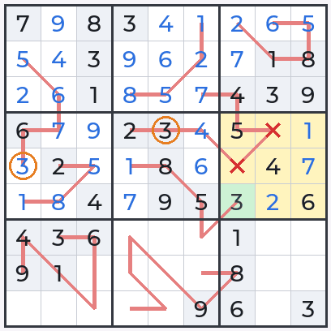

#### Step 32: the 8 in box 6

Box 6 needs an 8. r5c7: row 5 has one (r5c5). Only **r4c8** is left: **r4c8 = 8**.

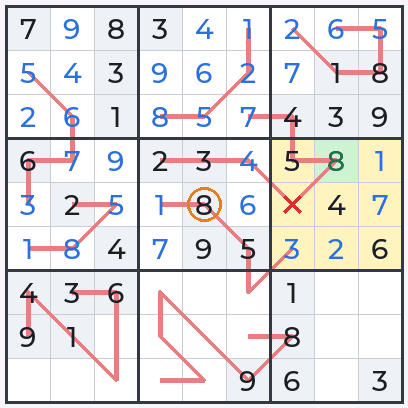

#### Step 33: the 9 in box 6

Box 6 needs a 9, and r5c7 is its last empty cell: **r5c7 = 9**.

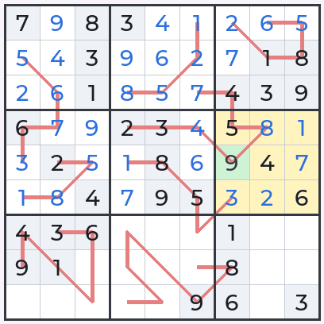

#### Step 34: the 2 in box 7

Box 7 needs a 2. r9c1: column 1 has one (r3c1). r9c2: column 2 has one (r5c2). r8c3: it's next to the 6 in r7c3 on a red line, and 2 is even too. Only **r9c3** is left: **r9c3 = 2**.

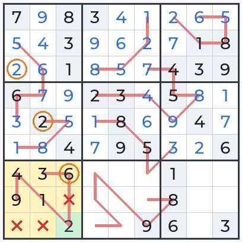

#### Step 35: the 5 in box 7

Box 7 needs a 5. r8c3: column 3 has one (r5c3). r9c1: column 1 has one (r2c1). Only **r9c2** is left: **r9c2 = 5**.

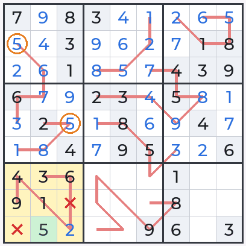

#### Step 36: the 7 in box 7

Box 7 needs a 7. r9c1: column 1 has one (r1c1). Only **r8c3** is left: **r8c3 = 7**.

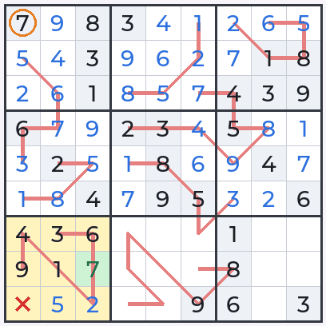

#### Step 37: the 8 in box 7

Box 7 needs an 8, and r9c1 is its last empty cell: **r9c1 = 8**.

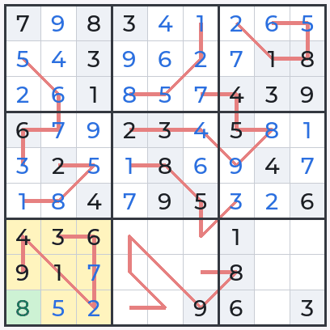

#### Step 38: the 1 in box 8

Box 8 needs a 1. r7c4, r7c5 and r7c6: row 7 has one (r7c7). r8c4, r8c5 and r8c6: row 8 has one (r8c2). r9c4: column 4 has one (r5c4). Only **r9c5** is left: **r9c5 = 1**.

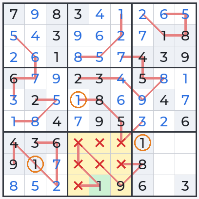

#### Step 39: the 3 in box 8

Box 8 needs a 3. r7c4, r7c5 and r7c6: row 7 has one (r7c2). r8c4: column 4 has one (r1c4). r8c5: column 5 has one (r4c5). r9c4: row 9 has one (r9c9). Only **r8c6** is left: **r8c6 = 3**.

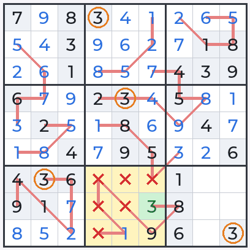

#### Step 40: the 5 in box 8

Box 8 needs a 5. r7c5 and r8c5: column 5 has one (r3c5). r7c6: column 6 has one (r6c6). r9c4: row 9 has one (r9c2). r8c4: it's next to the 1 in r9c5 on a red line, and 5 is odd too. Only **r7c4** is left: **r7c4 = 5**.

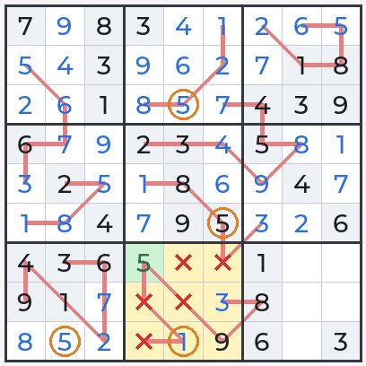

#### Step 41: the 6 in box 8

Box 8 needs a 6. r7c5 and r7c6: row 7 has one (r7c3). r8c5: column 5 has one (r2c5). r9c4: row 9 has one (r9c7). Only **r8c4** is left: **r8c4 = 6**.

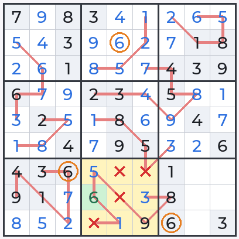

#### Step 42: the 4 in box 8

Box 8 needs a 4. r7c5 and r7c6: row 7 has one (r7c1). r8c5: column 5 has one (r1c5). Only **r9c4** is left: **r9c4 = 4**.

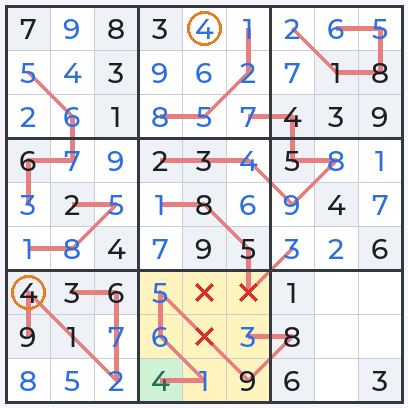

#### Step 43: the 7 in box 8

Box 8 needs a 7. r7c6: column 6 has one (r3c6). r8c5: row 8 has one (r8c3). Only **r7c5** is left: **r7c5 = 7**.

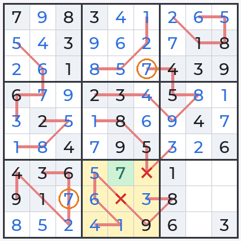

#### Step 44: the 2 in box 8

Box 8 needs a 2. r7c6: column 6 has one (r2c6). Only **r8c5** is left: **r8c5 = 2**.

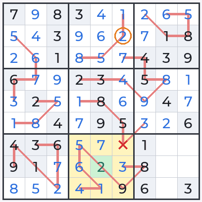

#### Step 45: the 8 in box 8

Box 8 needs an 8, and r7c6 is its last empty cell: **r7c6 = 8**.

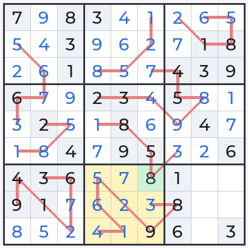

#### Step 46: the 2 in box 9

Box 9 needs a 2. r7c8: column 8 has one (r6c8). r8c8 and r8c9: row 8 has one (r8c5). r9c8: row 9 has one (r9c3). Only **r7c9** is left: **r7c9 = 2**.

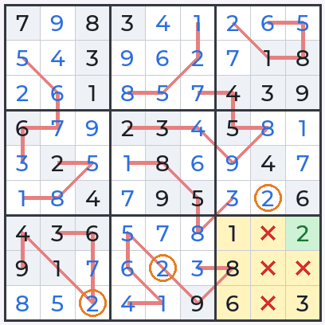

#### Step 47: the 4 in box 9

Box 9 needs a 4. r7c8: row 7 has one (r7c1). r8c8: column 8 has one (r5c8). r9c8: row 9 has one (r9c4). Only **r8c9** is left: **r8c9 = 4**.

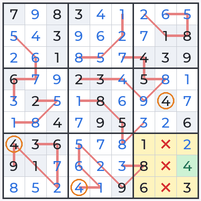

#### Step 48: the 5 in box 9

Box 9 needs a 5. r7c8: row 7 has one (r7c4). r9c8: row 9 has one (r9c2). Only **r8c8** is left: **r8c8 = 5**.

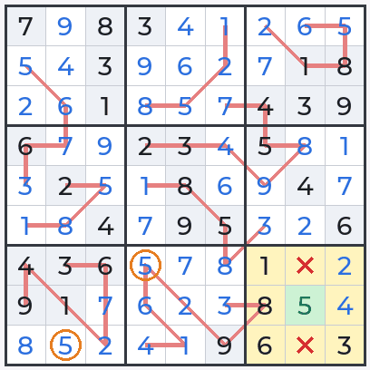

#### Step 49: the 7 in box 9

Box 9 needs a 7. r7c8: row 7 has one (r7c5). Only **r9c8** is left: **r9c8 = 7**.

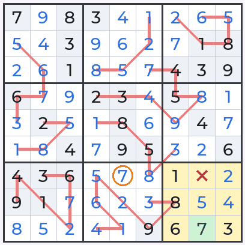

#### Step 50: the 9 in box 9

Box 9 needs a 9, and r7c8 is its last empty cell: **r7c8 = 9**.

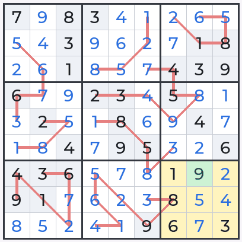

Solved.

<!-- /walkthrough -->
