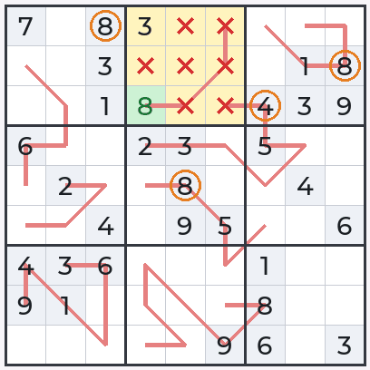

<!-- Written by tools/walkthrough.py parity-lines: edit the script, not this page. -->
# Parity Lines, step 1: the 8 in box 2

**Step 1 of 50** · [← The start](../parity-lines.md#the-whole-puzzle-step-by-step) · [All steps](../parity-lines.md#the-whole-puzzle-step-by-step) · [Step 2 →](step-02.md)

Box 2 needs an 8. r1c5 and r1c6: row 1 has one (r1c3). r2c4, r2c5 and r2c6: row 2 has one (r2c9). r3c5: column 5 has one (r5c5). r3c6: it's next to the 4 in r3c7 on a red line, and 8 is even too. Only **r3c4** is left: **r3c4 = 8**.

**Step 1 of 50** · [← The start](../parity-lines.md#the-whole-puzzle-step-by-step) · [All steps](../parity-lines.md#the-whole-puzzle-step-by-step) · [Step 2 →](step-02.md)
