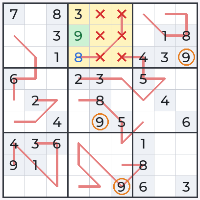

<!-- Written by tools/walkthrough.py parity-lines: edit the script, not this page. -->
# Parity Lines, step 2: the 9 in box 2

**Step 2 of 50** · [← Step 1](step-01.md) · [All steps](../parity-lines.md#the-whole-puzzle-step-by-step) · [Step 3 →](step-03.md)

Box 2 needs a 9. r1c5 and r2c5: column 5 has one (r6c5). r1c6 and r2c6: column 6 has one (r9c6). r3c5 and r3c6: row 3 has one (r3c9). Only **r2c4** is left: **r2c4 = 9**.

**Step 2 of 50** · [← Step 1](step-01.md) · [All steps](../parity-lines.md#the-whole-puzzle-step-by-step) · [Step 3 →](step-03.md)
