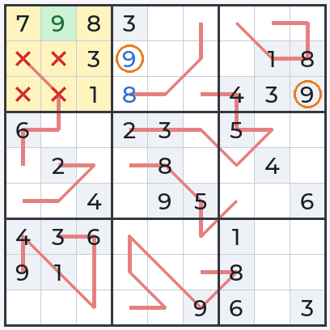

<!-- Written by tools/walkthrough.py parity-lines: edit the script, not this page. -->
# Parity Lines, step 3: the 9 in box 1

**Step 3 of 50** · [← Step 2](step-02.md) · [All steps](../parity-lines.md#the-whole-puzzle-step-by-step) · [Step 4 →](step-04.md)

Box 1 needs a 9. r2c1 and r2c2: row 2 has one (r2c4). r3c1 and r3c2: row 3 has one (r3c9). Only **r1c2** is left: **r1c2 = 9**.

**Step 3 of 50** · [← Step 2](step-02.md) · [All steps](../parity-lines.md#the-whole-puzzle-step-by-step) · [Step 4 →](step-04.md)
