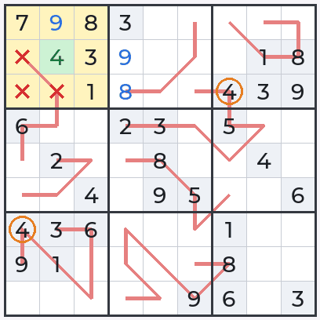

<!-- Written by tools/walkthrough.py parity-lines: edit the script, not this page. -->
# Parity Lines, step 4: the 4 in box 1

**Step 4 of 50** · [← Step 3](step-03.md) · [All steps](../parity-lines.md#the-whole-puzzle-step-by-step) · [Step 5 →](step-05.md)

Box 1 needs a 4. r2c1: column 1 has one (r7c1). r3c1 and r3c2: row 3 has one (r3c7). Only **r2c2** is left: **r2c2 = 4**.

**Step 4 of 50** · [← Step 3](step-03.md) · [All steps](../parity-lines.md#the-whole-puzzle-step-by-step) · [Step 5 →](step-05.md)
