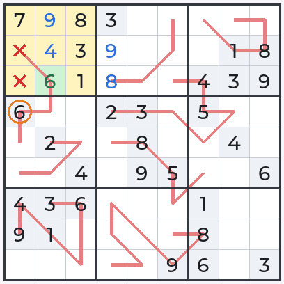

<!-- Written by tools/walkthrough.py parity-lines: edit the script, not this page. -->
# Parity Lines, step 5: the 6 in box 1

**Step 5 of 50** · [← Step 4](step-04.md) · [All steps](../parity-lines.md#the-whole-puzzle-step-by-step) · [Step 6 →](step-06.md)

Box 1 needs a 6. r2c1 and r3c1: column 1 has one (r4c1). Only **r3c2** is left: **r3c2 = 6**.

**Step 5 of 50** · [← Step 4](step-04.md) · [All steps](../parity-lines.md#the-whole-puzzle-step-by-step) · [Step 6 →](step-06.md)
