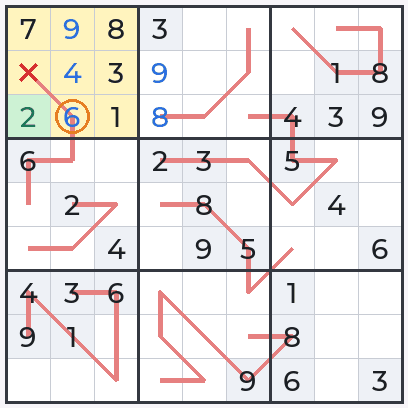

<!-- Written by tools/walkthrough.py parity-lines: edit the script, not this page. -->
# Parity Lines, step 6: the 2 in box 1

**Step 6 of 50** · [← Step 5](step-05.md) · [All steps](../parity-lines.md#the-whole-puzzle-step-by-step) · [Step 7 →](step-07.md)

Box 1 needs a 2. r2c1: it's next to the 6 in r3c2 on a red line, and 2 is even too. Only **r3c1** is left: **r3c1 = 2**.

**Step 6 of 50** · [← Step 5](step-05.md) · [All steps](../parity-lines.md#the-whole-puzzle-step-by-step) · [Step 7 →](step-07.md)
