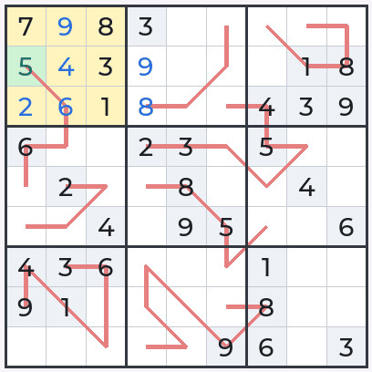

<!-- Written by tools/walkthrough.py parity-lines: edit the script, not this page. -->
# Parity Lines, step 7: the 5 in box 1

**Step 7 of 50** · [← Step 6](step-06.md) · [All steps](../parity-lines.md#the-whole-puzzle-step-by-step) · [Step 8 →](step-08.md)

Box 1 needs a 5, and r2c1 is its last empty cell: **r2c1 = 5**.

**Step 7 of 50** · [← Step 6](step-06.md) · [All steps](../parity-lines.md#the-whole-puzzle-step-by-step) · [Step 8 →](step-08.md)
