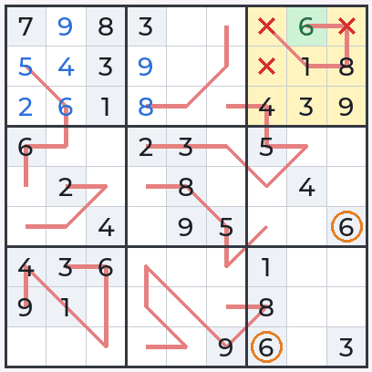

<!-- Written by tools/walkthrough.py parity-lines: edit the script, not this page. -->
# Parity Lines, step 8: the 6 in box 3

**Step 8 of 50** · [← Step 7](step-07.md) · [All steps](../parity-lines.md#the-whole-puzzle-step-by-step) · [Step 9 →](step-09.md)

Box 3 needs a 6. r1c7 and r2c7: column 7 has one (r9c7). r1c9: column 9 has one (r6c9). Only **r1c8** is left: **r1c8 = 6**.

**Step 8 of 50** · [← Step 7](step-07.md) · [All steps](../parity-lines.md#the-whole-puzzle-step-by-step) · [Step 9 →](step-09.md)
